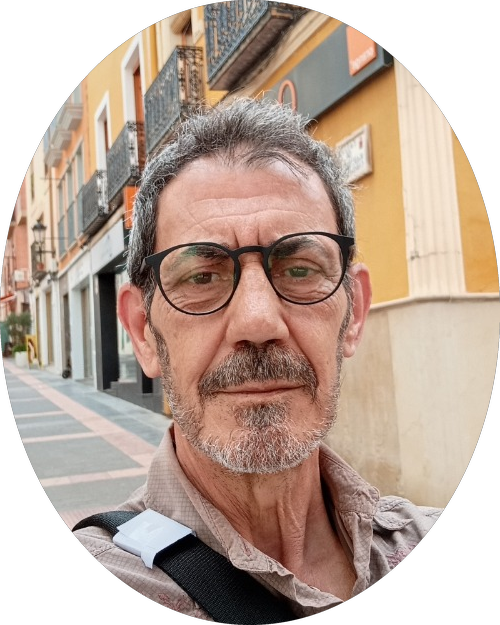
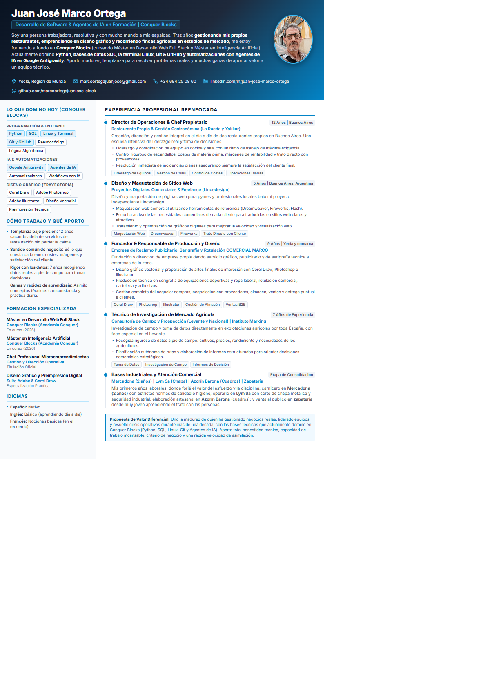

# Curriculum Vitae & Perfil Profesional — Juan José Marco Ortega

  

  <strong>Desarrollo de Software & Agentes de IA en Formación</strong> 
  <em>Estudiante de Máster Full Stack & Máster en Inteligencia Artificial en Conquer Blocks</em> 
  📍 Yecla, Región de Murcia, España

  
  
  

---

## 📌 Vista Previa del Currículum (Versión 1 Página)

  

---

## 📂 Contenido del Repositorio

| Archivo | Descripción |
|---|---|
| **[`CV_Juan_Jose_Marco_Ortega_1Pagina.pdf`](CV_Juan_Jose_Marco_Ortega_1Pagina.pdf)** | CV en formato PDF sintético (exactamente 1 página A4), ideal para filtros rápidos de selección y reclutadores. |
| **[`CV_Juan_Jose_Marco_Ortega_Completo.pdf`](CV_Juan_Jose_Marco_Ortega_Completo.pdf)** | CV en formato PDF extendido (2 páginas A4) con desglose de proyectos, trayectoria y competencias. |
| **[`cv_1pagina.html`](cv_1pagina.html)** | Código fuente HTML5 + CSS3 (diseño responsivo y @media print para impresión de 1 página A4 sin cortes). |
| **[`cv_2paginas.html`](cv_2paginas.html)** | Código fuente HTML5 + CSS3 para la versión de 2 páginas con avatar de cabecera continuo. |
| **[`perfil_estrategico_y_cv_juan_jose_marco.md`](perfil_estrategico_y_cv_juan_jose_marco.md)** | Guía estratégica con textos listos para copiar y pegar en LinkedIn (titulares, sección «Acerca de», experiencias). |
| **[`foto_perfil_oval.png`](foto_perfil_oval.png)** | Fotografía de presentación con recorte ovalado suave y transparencia PNG. |
| **[`foto_perfil.jpg`](foto_perfil.jpg)** | Fotografía de perfil en alta resolución (aspecto retrato 4:5). |
| **[`preview_1p.png`](preview_1p.png)** | Captura gráfica renderizada del currículum. |

---

## 🛠️ Stack Técnico & Competencias en Formación

* **Lenguajes & Bases de Datos:** Python, SQL, Lógica Algorítmica y Pseudocódigo.
* **Entorno & Herramientas:** Linux (terminal Bash), Git & GitHub, Google Antigravity.
* **Inteligencia Artificial & Automatización:** Agentes de IA, flujos de trabajo autónomos y automatizaciones.
* **Diseño & Preimpresión:** Corel Draw, Adobe Photoshop, Adobe Illustrator.
* **Habilidades Transferibles:** Liderazgo operativo (+12 años gestionando equipos y negocios propios en restauración), resiliencia, toma de decisiones bajo presión y sentido común de negocio.

---

## 📬 Contacto

* **Teléfono:** [+34 694 25 08 60](tel:+34694250860)
* **Correo Electrónico:** [marcoortegajuanjose@gmail.com](mailto:marcoortegajuanjose@gmail.com)
* **LinkedIn:** [linkedin.com/in/juan-jose-marco-ortega-8454912a2](https://www.linkedin.com/in/juan-jose-marco-ortega-8454912a2)
* **GitHub:** [github.com/marcoortegajuanjose-stack](https://github.com/marcoortegajuanjose-stack)
