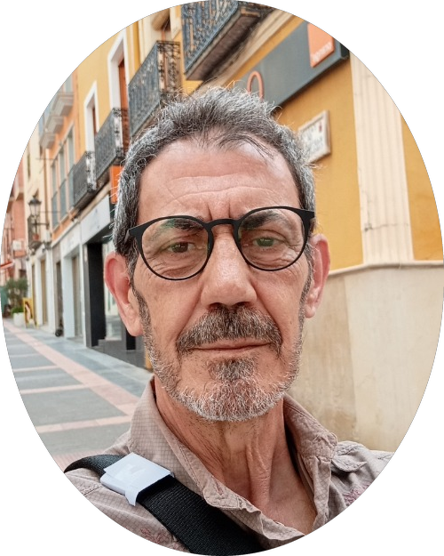

<p align="center">
  
</p>

# Estrategia de Perfil Profesional & Curriculum Vitae (Versión 2)
**Juan José Marco Ortega** | Yecla, Región de Murcia  
*Teléfono:* [+34 694 25 08 60](tel:+34694250860) | *Email:* [marcoortegajuanjose@gmail.com](mailto:marcoortegajuanjose@gmail.com)  
*LinkedIn:* [linkedin.com/in/juan-jose-marco-ortega-8454912a2](https://www.linkedin.com/in/juan-jose-marco-ortega-8454912a2)  
*GitHub:* [github.com/marcoortegajuanjose-stack](https://github.com/marcoortegajuanjose-stack)  
*Formación Actual:* Máster en Desarrollo Web Full Stack & Máster en Inteligencia Artificial en **Conquer Blocks**

---

## 1. La Narrativa: Quién eres, de forma natural y transparente

En el mundo de la tecnología se valora cada vez más a las personas reales: gente con madurez, con experiencia de vida, que sabe hablar con un cliente, que no se asusta ante los imprevistos y que no intenta aparentar lo que no es.

Tu historia contada de forma cercana y profesional:

> **"Soy una persona inquieta y trabajadora. He llevado negocios propios durante más de una década, he liderado equipos en cocinas y salas con el ritmo frenético de Buenos Aires, he tenido mi propia empresa de publicidad y diseño gráfico en Yecla y he recorrido España en estudios de mercado agrícola. Ahora he vuelto a lo que siempre me atrajo: la tecnología. En Conquer Blocks estoy aprendiendo con disciplina diaria Python, SQL, Linux y Agentes de IA. No vendo humo: aporto ganas incansables, criterio práctico y la sensatez de quien ya sabe cómo funciona el mundo real."**

---

## 2. Textos Listos para LinkedIn (Tono Cercano y Profesional)

### A. Titulares Profesionales sugeridos

* **Opción 1 (Directa, honesta y con tus herramientas clave):**
  > **Desarrollo de Software & Agentes de IA en formación @ Conquer Blocks | Python, SQL, Linux, Git | +12 años gestionando negocios propios y resolviendo problemas reales**

* **Opción 2 (Enfocada a automatización y sentido común):**
  > **Programación con Python, SQL & Agentes de IA | Automatizaciones con Google Antigravity | Estudiante en Conquer Blocks | Trayectoria en Hostelería, Publicidad y Datos**

* **Opción 3 (Corta y contundente):**
  > **En formación en Full Stack & IA (Conquer Blocks) | Python, Bases de Datos SQL, Linux CLI | Gestión de equipos, resiliencia y templanza**

---

### B. Sección "Acerca de" (About Me)
*(Copia y pega este texto en tu perfil de LinkedIn)*

```markdown
Soy una persona trabajadora, curiosa y con mucho mundo a mis espaldas. Tras años emprendiendo en diseño gráfico, gestionando mis propios restaurantes y recorriendo fincas agrícolas en estudios de mercado, he decidido volver a una de mis grandes pasiones: la informática y el desarrollo.

Actualmente me estoy formando intensamente en Conquer Blocks en el Máster en Desarrollo Web Full Stack y el Máster en Inteligencia Artificial.

Lo que domino y practico a día de hoy:
💻 Lógica & Programación: Pseudocódigo, algoritmia y programación con Python.
🗄️ Bases de Datos: Modelado relacional y consultas con SQL.
🐧 Entorno de Trabajo: Manejo de la terminal Linux (Bash), control de versiones con Git y gestión de repositorios en GitHub.
🤖 Inteligencia Artificial: Automatización de flujos y trabajo con Agentes de IA en Google Antigravity.
🎨 Diseño Gráfico: Amplio dominio práctico de Corel Draw, Adobe Photoshop y Adobe Illustrator.

Mi recorrido no es el tradicional, y esa es mi gran ventaja:
▸ 12 años como Chef y Propietario de mis propios restaurantes en Buenos Aires (La Rueda y Yakkar): templanza, gestión de equipos bajo máxima presión y control de costes al milímetro.
▸ 5 años creando y maquetando sitios web para pymes locales bajo mi proyecto independiente Lincedesign en Buenos Aires.
▸ 9 años como Fundador y Responsable de Comercial Marco en Yecla: serigrafía técnica, rotulación, compras, ventas B2B y trato directo con clientes.
▸ 7 años recorriendo fincas agrícolas en toda España para el Instituto Marking: recogida rigurosa de datos a pie de campo e informes para decisiones estratégicas.

Aporto honestidad técnica absoluta, capacidad de trabajo constante, visión práctica de negocio y una gran velocidad para aprender lo que haga falta.

📍 Yecla, Región de Murcia (disponible para proyectos remotos o presenciales).
📬 E-mail: marcoortegajuanjose@gmail.com | 📞 694 25 08 60
🐙 GitHub: github.com/marcoortegajuanjose-stack
```

---

### C. Experiencias Laborales para LinkedIn (En el orden que pediste)

#### 1. Especialización Técnica en Conquer Blocks
* **Cargo:** Especialización en Desarrollo de Software & Agentes de IA
* **Empresa:** Conquer Blocks (Academia Conquer)
* **Periodo:** 2026 - Actualidad
* **Descripción:**
  ```text
  - Aprendizaje y aplicación práctica de algoritmia, pseudocódigo y estructuras de datos.
  - Dominio de la terminal Linux y control de versiones profesional con Git y GitHub.
  - Desarrollo de lógica con Python y diseño / consultas de bases de datos relacionales con SQL.
  - Creación de automatizaciones y trabajo asistido con Agentes de Inteligencia Artificial en Google Antigravity.
  ```

#### 2. Restauración Propia en Buenos Aires
* **Cargo:** Director de Operaciones & Chef Propietario (12 Años)
* **Empresa:** Restaurante Propio & Gestión Gastronómica (La Rueda y Yakkar)
* **Ubicación:** Buenos Aires, Argentina
* **Descripción:**
  ```text
  - Creación, dirección y gestión diaria de dos restaurantes propios en Buenos Aires.
  - Liderazgo y coordinación de equipo en cocina y sala con un ritmo diario de máxima exigencia.
  - Control riguroso de escandallos, costes de materia prima, márgenes de rentabilidad y trato directo con distribuidores.
  - Resolución inmediata de incidencias diarias asegurando la calidad del servicio y la satisfacción del cliente.
  ```

#### 3. Desarrollo Web y Maquetación (Lincedesign)
* **Cargo:** Diseño y Maquetación de Sitios Web (5 Años)
* **Empresa:** Proyectos Digitales Comerciales & Freelance (Lincedesign)
* **Ubicación:** Buenos Aires, Argentina
* **Descripción:**
  ```text
  - Diseño y maquetación de páginas web para pymes y profesionales locales bajo mi proyecto independiente Lincedesign.
  - Maquetación web comercial utilizando herramientas pioneras de referencia (Dreamweaver, Fireworks, Flash).
  - Escucha activa de las necesidades de cada cliente para traducirlas en sitios web claros y atractivos.
  - Tratamiento y optimización de gráficos digitales para reducir tiempos de carga y mejorar la experiencia.
  ```

#### 4. Publicidad, Serigrafía y Diseño (Comercial Marco)
* **Cargo:** Fundador & Responsable de Producción y Diseño (9 Años)
* **Empresa:** Empresa de Reclamo Publicitario, Serigrafía y Rotulación COMERCIAL MARCO
* **Ubicación:** Yecla y comarca
* **Descripción:**
  ```text
  - Fundación y dirección de empresa propia dando servicio gráfico, publicitario y de serigrafía técnica a empresas de la zona.
  - Diseño gráfico vectorial y preparación de artes finales de impresión con Corel Draw, Photoshop e Illustrator.
  - Producción técnica en serigrafía de equipaciones deportivas y ropa laboral, rotulación comercial, cartelería y adhesivos.
  - Gestión completa del negocio: compras, negociación con proveedores, almacén, ventas y entrega puntual a clientes.
  ```

#### 5. Estudios de Mercado Agrícola (Instituto Marking)
* **Cargo:** Técnico de Investigación de Mercado Agrícola (7 Años)
* **Empresa:** Consultoría de Campo y Prospección (Levante y Nacional) | Instituto Marking
* **Descripción:**
  ```text
  - Investigación de campo y toma de datos directamente en explotaciones agrícolas por toda España, con especial foco en el Levante.
  - Recogida rigurosa de datos a pie de campo: cultivos, precios, rendimiento y necesidades de los agricultores.
  - Planificación autónoma de rutas y elaboración de informes estructurados para orientar decisiones comerciales estratégicas.
  ```

#### 6. Trayectoria Base en Industria y Comercio
* **Cargo:** Operario Industrial y Atención al Cliente (Etapa de Consolidación)
* **Empresas:** Mercadona (Carnicería - 2 años) | Lym Sa (Chapa) | Azorín Barona (Cuadros) | Zapatería
* **Descripción:**
  ```text
  - Mercadona (2 años): Sección cárnica, atención al público bajo estrictas normas de higiene, calidad y trabajo en equipo.
  - Lym Sa: Operario técnico en planta de perfiles de chapa metálica (precisión milimétrica y seguridad industrial).
  - Azorín Barona: Fabricación artesanal de cuadros y molduras (cuidado del detalle y acabado estético).
  - Comercio de calzado: Primeros pasos laborales en zapatería aprendiendo el trato directo con las personas.
  ```

---

### D. Idiomas
* **Español:** Nativo
* **Inglés:** Básico (aprendiendo día a día con ganas)
* **Francés:** Nociones básicas (en el recuerdo)

